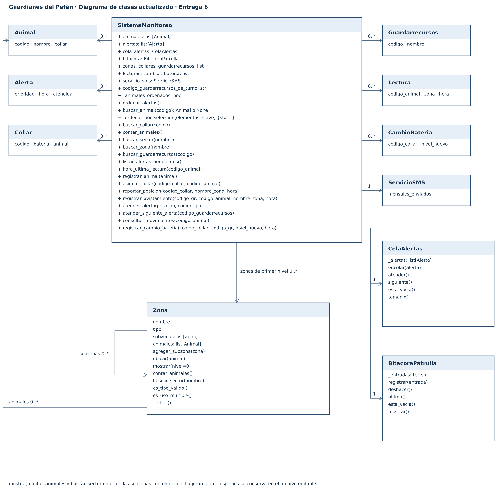
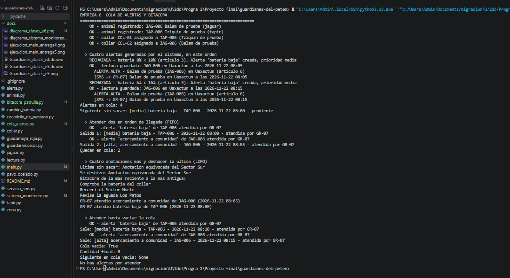

# Guardianes del Petén · Entrega 6

- Estudiante Julio César Carías Vargas
- Carné 202604158
- Grupo IS24-FP2
- Fecha 23 de noviembre de 2026

Ejecutar `py main.py` en Windows o `python3 main.py`.

## Cambios de esta entrega

Se agregan cola_alertas.py y bitacora_patrulla.py. Se modifican
sistema_monitoreo.py y main.py para integrar y probar las dos estructuras.

ColaAlertas usa una lista privada. encolar agrega al final, atender extrae
del frente y siguiente consulta sin extraer. Esta estructura aplica FIFO.

BitacoraPatrulla usa una lista privada. registrar agrega al final, deshacer
extrae la última y ultima consulta sin extraer. mostrar imprime desde la
entrada más reciente hasta la más antigua. Esta estructura aplica LIFO.
Las consultas y extracciones vacías devuelven None.

Cada alerta generada por batería baja o acercamiento se guarda en el historial
y se encola como el mismo objeto. Ordenar el historial por prioridad conserva
el orden de llegada de la cola.

atender_siguiente_alerta valida R7 antes de retirar una alerta pendiente,
reutiliza atender_alerta y su guarda R8 y registra la atención en la bitácora.
Si una alerta ya se atendió por el método anterior, se descarta al llegar al
frente de la cola para evitar una segunda atención.

## Pruebas

main.py conserva las pruebas de Entregas 1 a 5 y añade una reserva de prueba
independiente para observar cuatro llegadas sin mezclar atenciones previas.

1. Genera cuatro alertas mediante reportar_posicion. La cola tiene tamaño 4.
2. Muestra la siguiente sin retirarla y atiende las llegadas 08:00 y 08:05.
3. Añade cuatro anotaciones y deshace "Anotacion equivocada del Sector Sur".
4. Muestra las cinco entradas restantes de más reciente a más antigua.
5. Atiende las llegadas 08:10 y 08:15 y muestra tamaño 0 y siguiente None.
6. Intenta atender una vez más y muestra "No hay alertas por atender".

Las dos primeras atenciones demuestran que la alerta media de 08:00 sale
antes que la alta de 08:05, según el orden de llegada.

## Diagrama actualizado

[Diagrama editable con el sistema y la jerarquía de especies](docs/Guardianes_clases_e6.drawio)

## Evidencia

La imagen siguiente representa el texto obtenido al ejecutar main.py.
Puede reemplazarse por una captura tomada en la terminal local.

