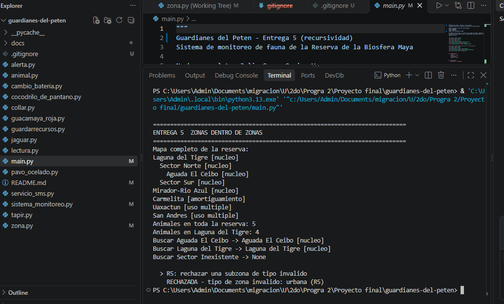

# Guardianes del Petén · Entrega 5

- Estudiante Julio César Carías Vargas
- Carné 202604158
- Grupo IS24-FP2
- Fecha 15 de noviembre de 2026

Ejecutar `py main.py` en Windows o `python3 main.py`.

## Cambios

`zona.py` incorpora subzonas, animales, agregar_subzona y ubicar. mostrar,
contar_animales y buscar_sector recorren el árbol mediante recursión.
La inserción de subzonas valida su tipo con la guarda R5 antes de agregarlas.

`sistema_monitoreo.py` cuenta desde las raíces y busca sectores recursivamente.
buscar_zona delega en esa búsqueda para aceptar posiciones y avistamientos
en subzonas registradas.

`main.py` conserva las pruebas anteriores y agrega un mapa de ocho zonas,
con tres niveles bajo la reserva. Ubica cinco animales en distintos niveles.

Resultados esperados de la Entrega 5
- Reserva completa, 5 animales.
- Laguna del Tigre, 4 animales.
- Aguada El Ceibo, encontrado en el nivel más profundo.
- Laguna del Tigre, encontrado en primer nivel.
- Sector Inexistente, None.
- Zona de tipo urbana, rechazada por R5.

Las zonas de primer nivel se guardan en sistema.zonas. Cada subzona se agrega
solo a su padre. La demostración ubica una vez a cada animal.
Las ubicaciones de esta demostración son explícitas mediante ubicar.

[Diagrama editable](docs/Guardianes_clases_e5.drawio)

## Evidencia

Ejecutar main.py y guardar la captura de las pruebas de Entrega 5 en
`docs/ejecucion_main_entrega5.png`.

