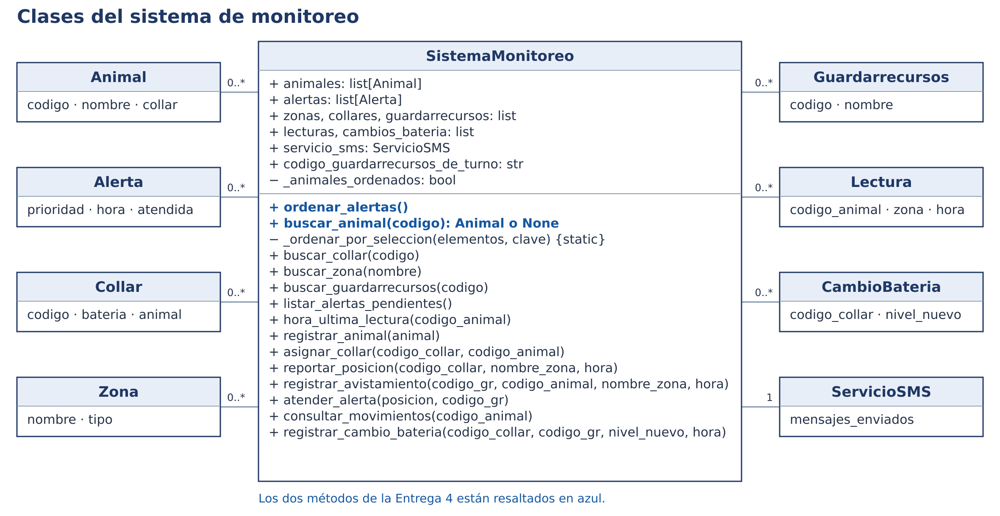
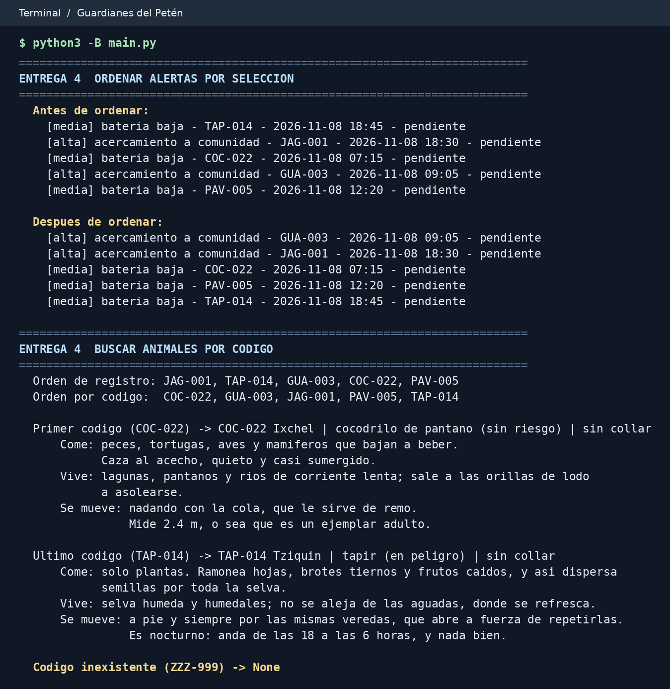

# Guardianes del Petén · Entrega 4

- **Estudiante** Julio César Carías Vargas
- **Carné** 202604158
- **Grupo** IS24-FP2
- **Curso** Fundamentos de Programación 2
- **Fecha** 8 de noviembre de 2026

Sistema de monitoreo de fauna de la Reserva de la Biosfera Maya. Esta entrega agrega el ordenamiento de alertas y la búsqueda binaria de animales a los siete casos de uso de las entregas anteriores.

## Ejecución

Se necesita Python 3. Desde la carpeta que contiene `main.py`, ejecutar:

```bash
python3 main.py
```

En Windows también se puede usar `py main.py`.

## Ordenamiento y búsqueda

- `ordenar_alertas()` ordena la lista de alertas en su lugar. En cada pasada selecciona la menor clave `(nivel, hora)` y hace como máximo un intercambio. El nivel 1 corresponde a la prioridad alta y el 2 a la media. Las horas ISO `AAAA-MM-DD HH:MM` se comparan cronológicamente como texto.
- `buscar_animal(codigo)` prepara la lista por código con la misma selección. La primera búsqueda y la que sigue a un registro nuevo ordenan la lista. Con la lista ordenada, la búsqueda compara el elemento del medio y descarta la mitad que queda fuera del rango. Devuelve el objeto de la especie o `None` si el código no existe.

## Resultados de main

El programa imprime cinco alertas antes y después de ordenarlas. Las dos altas quedan a las **09:05** y **18:30**, seguidas de las tres medias a las **07:15**, **12:20** y **18:45**.

| Código | Caso | Resultado |
| --- | --- | --- |
| `COC-022` | Primero por código | Ixchel, cocodrilo de pantano |
| `TAP-014` | Último por código | Tziquin, tapir |
| `ZZZ-999` | Código inexistente | `None` |

El programa también ejecuta la demostración de polimorfismo y los casos de registro, asignación de collar, reporte, avistamiento, atención de alertas, consulta de movimientos y cambio de batería.

## Diagrama y evidencia

[Diagrama de clases editable](docs/Guardianes_clases_e4.drawio) con la jerarquía de especies y la clase central actualizada.



Fragmento de la ejecución de `main.py` con las dos pruebas de esta entrega.


# guardianes-del-peten
